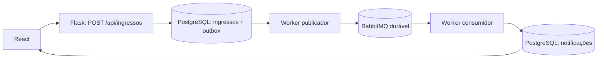

# C★ — Mensageiro Interestelar: RabbitMQ real e processamento assíncrono

## Critérios de aceite

| Critério | Evidência no código |
|---|---|
| Producer publica em broker real Docker | `workers/publicador.py` usa `pika.BlockingConnection`, fila durável `culturapass.ingressos.v1`, mensagens persistentes, `confirm_delivery()` |
| Consumer separado e assíncrono | `workers/consumidor.py` em container distinto, `basic_consume`, transação de notificação, `ACK` após commit |
| Rota original funciona sem broker | `services/ingressoService.py` insere `Ingresso` e `Outbox` via **uma transação PostgreSQL**, sem abrir qualquer conexão RabbitMQ na requisição |

## Diagrama



## Integridade e recuperação

- A compra grava **ingresso + evento outbox no mesmo commit**. Falhou a gravação? Não existe ingresso sem evento a publicar.
- O publicador lê mensagens `PENDENTE`, tenta entrega com `publisher confirms`, marca `ENVIADO` apenas depois da confirmação. Se cair, aplica espera exponencial (até 120 segundos).
- Uma falha entre o ACK do broker e a atualização do outbox pode causar retransmissão. A tabela `notificacoes` usa `chave_evento UNIQUE`, tornando o consumidor **idempotente**.
- O consumidor só executa `ACK` depois de salvar a notificação. Em falha, usa `NACK(requeue=True)`.
- A interface consulta `/api/notificacoes`; CLIENTE vê apenas mensagens associadas ao próprio `cliente_id`.
- Não são utilizadas filas em memória. A fila é persistente no RabbitMQ e a fonte confiável dos eventos pendentes é o PostgreSQL.

## Demonstração em Docker

1. Suba o ambiente: `docker compose up --build -d`.
2. Faça login, crie um evento futuro e um cliente, depois emita um ingresso. Consulte **Notificações**.
3. Pare apenas o broker com `docker compose stop rabbitmq`.
4. Emita um novo ingresso pelo mesmo formulário. **O HTTP deve retornar `201`** e o registro fica pendente, mesmo sem RabbitMQ.
5. Verifique a fila pendente no banco:

```powershell
docker compose exec db psql -U culturapass -d culturapass -c "SELECT id, tipo, estado, tentativas FROM outbox_eventos ORDER BY id DESC LIMIT 10;"
```

6. Reative o broker: `docker compose start rabbitmq`.
7. Consulte `docker compose logs --tail 100 publicador consumidor`. Atualize a tela de notificações e confira o estado `ENVIADO` do outbox.
8. A interface de administração RabbitMQ pode ser acessada em `http://localhost:15672`, com o usuário/senha locais do `.env`.

## Testes

Os testes em `backend/tests/test_ingressos_regras.py` validam que o POST cria outbox sem acesso a Pika/RabbitMQ; `test_notificacoes.py` verifica idempotência. A entrega não alega que a publicação real e o comportamento de queda foram executados neste ambiente. A demonstração em Docker é necessária para comprovação completa.

## Limites atuais

O consumidor reenfileira mensagens com erro em vez de usar uma DLQ; em produção, configurar DLQ e alarme de tentativas. A publicação não é exatamente-uma-vez; o modelo é *at-least-once* com consumidor idempotente. A aplicação não envia emails ou mensagens externas, apenas notificações persistidas para consulta.
